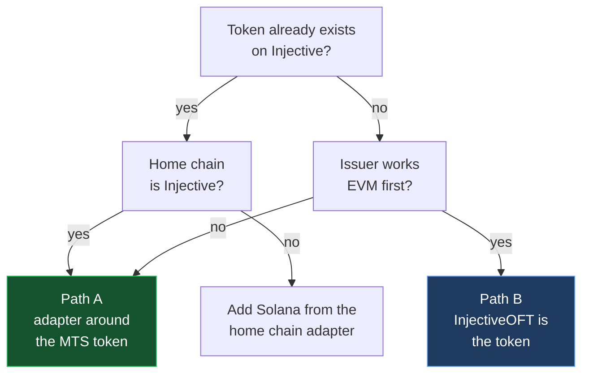
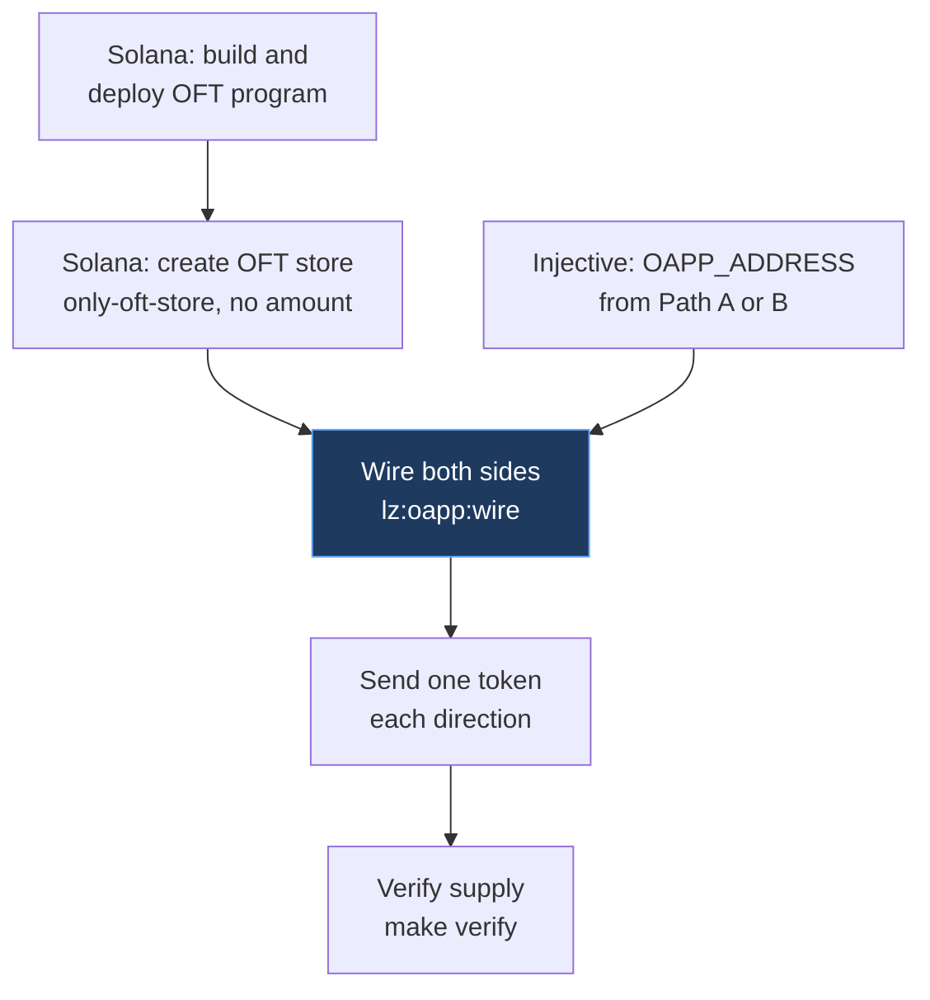

# LayerZero OFT on Injective EVM: a token that works on Solana and on the native side

Two ways to issue a token on Injective that LayerZero can carry to Solana, with the balances in the bank module so the same token also works in Helix, the exchange module, IBC and native wallets.

| Path | Token contract | LayerZero contract on Injective | Supply model | Best for |
|---|---|---|---|---|
| **A: native first** | `MintBurnBankERC20`, deployed by the chain during pair creation | `InjectiveOFTAdapter` (lock and unlock) | Injective is the home chain, Solana mints and burns | an existing tokenfactory token, or a new token whose supply should be governed natively |
| **B: EVM first** | `InjectiveOFT`, inherits the chain's BankERC20 backed `OFT` | the token itself (burn and mint) | symmetric, any chain can be home | an EVM native issuer, or a token that already has an OFT elsewhere and wants Injective as a spoke |

What both paths avoid: LayerZero's stock `OFT.sol` as the token. It inherits OpenZeppelin `ERC20` and keeps balances in contract storage, so on Injective it works in MetaMask and nowhere else. Pairing it later does not repair that.



An existing token with a home elsewhere, for example an Ethereum token already on Injective through Peggy, does not get a second adapter on Injective. LayerZero allows one lockbox per token mesh, and a second one splits the supply with no way to reconcile it.

## Prerequisites

- `forge` and `cast` (Foundry), `injectived`, `jq`, `python3`
- A funded testnet key. The same private key is used on the EVM side (`0x...`) and the native side (`inj1...`). Faucet: https://testnet.faucet.injective.network/
- For the Solana half: the LayerZero `oft-solana` example checked out separately, with its own prerequisites (Rust, Anchor, Solana CLI, pnpm). https://github.com/LayerZero-Labs/devtools/tree/main/examples/oft-solana

```bash
forge install InjectiveLabs/solidity-contracts
forge install foundry-rs/forge-std
cp .env.example .env     # fill in keys and addresses
injectived keys unsafe-import-eth-key $INJ_KEY_NAME <PRIVATE_KEY without 0x> --keyring-backend file
make build
```

`solidity-contracts` carries LayerZero and OpenZeppelin as its own submodules, which is why one install covers every import. `via_ir = true` in `foundry.toml` is required: the BankERC20 backed OFT constructor forwards five arguments to two base constructors and the legacy codegen reports "Stack too deep".

## Path A: native first

### 1. Create the token in one native transaction

```bash
make create-native-token
```

The script builds one transaction with three messages and signs it with `injectived`:

1. `MsgCreateDenom` with name, symbol and decimals, so bank metadata is complete from the first block (10 INJ fee).
2. `MsgMint` of `INITIAL_SUPPLY`. `CreateTokenPair` rejects a denom with zero supply.
3. `MsgCreateTokenPair` with an empty ERC20 address. The chain deploys `MintBurnBankERC20` with the deployer's EVM address as owner.

Gas is fixed at 3.5M. The template deploy inside `CreateTokenPair` is hardcoded at 2M and simulation returns about 1.28M, so an auto estimated transaction fails. The script prints the ERC20 address of the new pair. Put it in `.env` as `MTS_ERC20_ADDRESS`.

### 2. Deploy the adapter

```bash
make deploy-adapter
```

`InjectiveOFTAdapter` is LayerZero's `OFTAdapter` with nothing added:

```solidity
contract InjectiveOFTAdapter is OFTAdapter {
    constructor(address token, address lzEndpoint, address delegate)
        OFTAdapter(token, lzEndpoint, delegate) Ownable(delegate) {}
}
```

On send it calls `transferFrom` on the MTS token, which moves the bank balance from the sender to the adapter. On receive it calls `transfer` back out. Bank total supply never changes through bridging. The adapter's bank balance is the amount in flight on Solana. Put the adapter address in `.env` as `OAPP_ADDRESS`.

## Path B: EVM first

```bash
make deploy-oft
```

`InjectiveOFT` inherits the chain's `OFT` from [`solidity-contracts/src/oft-evm/BankOFT.sol`](https://github.com/InjectiveLabs/solidity-contracts/blob/master/src/oft-evm/BankOFT.sol), which is LayerZero's `OFTCore` on top of `BankERC20` instead of OpenZeppelin `ERC20`:

```solidity
import { OFT } from "@injectivelabs/solidity-contracts/src/oft-evm/BankOFT.sol";

contract InjectiveOFT is OFT {
    constructor(string memory name_, string memory symbol_, uint8 decimals_, address lzEndpoint, address delegate)
        payable OFT(name_, symbol_, decimals_, lzEndpoint, delegate) Ownable(delegate) {}

    function mint(address to, uint256 amount) external onlyOwner { _mint(to, amount); }

    receive() external payable {}
}
```

The constructor writes name, symbol and decimals to the bank module through the precompile. `_debit` burns and `_credit` mints through `BankERC20._update`, so every LayerZero transfer changes bank supply under the denom `erc20:<contract address>`. No pair creation message is needed, the precompile derives the denom from the contract address.

`DEPLOY_VALUE` funds the contract with INJ. The chain debits 1 INJ from the contract's own balance when the first mint creates the denom. An unfunded contract fails its first inbound transfer with `failed to mint`, which is why the constructor is `payable` and the contract has a `receive()`.

`mint` is for a deployment where Injective is the home chain. A spoke deployment never calls it, supply arrives through `lzReceive`. Put the contract address in `.env` as `OAPP_ADDRESS`.

## Bridging to Solana

Both paths look the same to LayerZero from here: one OApp on Injective, one OFT Store on Solana, one wired pathway.



### 1. Solana program and OFT Store

From the LayerZero `oft-solana` example:

```bash
anchor keys sync -p oft
anchor build -v -e OFT_ID=<OFT_PROGRAM_ID>
solana program deploy --program-id target/deploy/oft-keypair.json target/verifiable/oft.so -u devnet --with-compute-unit-price <PRICE>

pnpm hardhat lz:oft:solana:create --eid 40168 --program-id <OFT_PROGRAM_ID> --only-oft-store true
```

No `--amount`. Supply originates on Injective, Solana starts empty. `--only-oft-store true` makes the OFT Store the only mint authority and cannot be changed later, which is what prevents a second minter from creating Solana supply the Injective side cannot redeem. Put the printed OFT Store address in `.env` as `SOLANA_OFT_STORE`.

### 2. Wire

Copy `layerzero/hardhat.networks.ts` entries into the example's `hardhat.config.ts`, and `layerzero/layerzero.config.ts` over its config. The Injective contract is referenced by `address`, since it was deployed with Foundry rather than hardhat-deploy.

```bash
npx hardhat lz:oft:solana:init-config --oapp-config layerzero.config.ts
pnpm hardhat lz:oapp:wire --oapp-config layerzero.config.ts
```

Wiring sets peers on both sides and applies the DVN configuration through each endpoint. On testnet the only verifier present on both Injective testnet and Solana devnet is LayerZero Labs, so the config has one required DVN. On mainnet LayerZero Labs, Twinstake, Horizen and Canary are on both chains.

`make set-peer` does the Injective half with `cast` for the case where the wire task is not in use. It does not configure DVNs.

### 3. Send and verify

```bash
npx hardhat lz:oft:send --src-eid 40408 --dst-eid 40168 --to <SOLANA_ADDRESS> --amount 1
npx hardhat lz:oft:send --src-eid 40168 --dst-eid 40408 --to <EVM_ADDRESS> --amount 1
make verify
```

`make verify` prints the EVM `totalSupply()` and the bank supply side by side. They match for an MTS token on both paths. For Path A it also prints the adapter's balance from the EVM view and from the bank view, which equals Solana supply scaled by the decimals difference.

## Endpoint reference

| | Injective EVM mainnet | Injective EVM testnet |
|---|---|---|
| LayerZero eid | `30394` | `40408` |
| EVM chain ID | 1776 | 1439 |
| EndpointV2 | `0x6f475642a6e85809b1c36fa62763669b1b48dd5b` | `0x3acaaf60502791d199a5a5f0b173d78229ebfe32` |
| JSON-RPC | `https://sentry.evm-rpc.injective.network/` | `https://k8s.testnet.json-rpc.injective.network/` |
| Explorer | `https://blockscout.injective.network/` | `https://testnet.blockscout.injective.network/` |

Solana: mainnet eid `30168`, devnet eid `40168`. The LayerZero enum `INJECTIVE_V2_TESTNET` (eid 40218) is the retired inEVM testnet, not Injective EVM.

## Known traps

- **Stock `OFT.sol` as the token.** Compiles, deploys, bridges, and is invisible to everything on Injective outside the EVM. The only fix is a holder migration to an MTS contract.
- **Pairing a stock ERC20 later.** `MsgCreateTokenPair` checks that the address has code and answers `symbol()`. It does not check that balances go through the precompile. The result is a pair whose EVM supply and bank supply drift, and unwinding it needs governance.
- **Unfunded Path B contract.** The first mint charges 1 INJ from the contract's balance. Fund it at deploy or send INJ to it before the first inbound transfer.
- **`--amount` on `lz:oft:solana:create`.** Pre-mints supply on Solana that nothing on Injective backs.
- **Auto estimated gas on the native transaction.** `CreateTokenPair` needs 3M or more.
- **Decimals.** `OFTCore` reads `decimals()` from the token at construction. Shared decimals default to 6, so a 6 decimal token sends every base unit and an 18 decimal token sends in units of 10^12.
- **Permissioned tokens.** A token with a permissions namespace treats the adapter as an ordinary account. It needs whatever role lets it hold and send the token.

## Files

| File | Purpose |
|---|---|
| `src/InjectiveOFT.sol` | Path B token, inherits the chain's BankERC20 backed [`OFT`](https://github.com/InjectiveLabs/solidity-contracts/blob/master/src/oft-evm/BankOFT.sol) |
| `src/InjectiveOFTAdapter.sol` | Path A adapter, LayerZero `OFTAdapter` unchanged |
| `script/DeployOFT.s.sol`, `script/DeployAdapter.s.sol` | Foundry deploy scripts, read `.env` |
| `scripts/create-native-token.sh` | Path A step 1, the three message native transaction |
| `scripts/set-peer.sh` | `setPeer` on the Injective OApp with base58 to bytes32 conversion |
| `scripts/verify.sh` | bank supply vs EVM supply, adapter balance from both views |
| `layerzero/hardhat.networks.ts` | Injective network entries for the LayerZero example |
| `layerzero/layerzero.config.ts` | Injective testnet to Solana devnet pathway, one required DVN |
